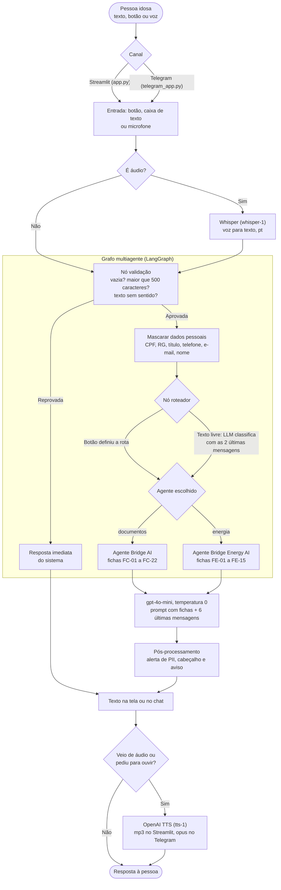

# Relatório Técnico — Bridge AI Energy: Assistente Digital de Orientação ao Cidadão Idoso

*Soluções em Energias Renováveis e Sustentáveis - Global Solution 2026.2* 

**Integrantes**

- **Thiago Soalheiro Diamantino** — RM 569316
- **Kauan Damasceno de Lima** — RM 573727

---

**Público atendido:** pessoas idosas que vivem em propriedades e comunidades rurais.  
**Escopo:** comparação de alternativas de bombeamento de água e fornecimento de energia para uma propriedade rural de pequeno porte.  
**Bot no Telegram:** [t.me/Bridge_AI_Energy_bot](https://t.me/Bridge_AI_Energy_bot)  
**Interface web:** Streamlit (`streamlit run app.py`; instruções na seção 0)  
**Contribuição desta disciplina ao projeto:** agente *Bridge Energy AI*, fichas `referencia/energia/FE-*.md`, este relatório e `calculos_comparacao.py` (ver seção 10.1)

> **Nota metodológica:** Os valores marcados como **[FONTE]** têm respaldo em fontes públicas identificadas na seção 13. Os valores marcados como **[EST]** são premissas de simulação e precisam ser confirmados com medição, conta de energia, avaliação da fonte de água e orçamentos locais. Economia, geração, autonomia e prazo de retorno não são garantidos.

---

---

## 0 Instalação e execução

> **Pré-requisitos:** Python 3.10 ou superior, uma chave da API da OpenAI (uso pago) e, para o Telegram, o token de um bot criado no [@BotFather](https://t.me/BotFather). Nada é instalado ou executado com chaves reais no repositório: as chaves ficam sempre fora do Git.


### 0.2 Instalação local

```bash
git clone https://github.com/o-kauan/1CCA_GS_2-Semestre.git
cd "1CCA_GS_2-Semestre/Soluções em Energias Renováveis e Sustentáveis"

python -m venv .venv
source .venv/bin/activate          # Windows (PowerShell): .venv\Scripts\Activate.ps1
pip install -r requirements.txt
```

Em seguida, defina as chaves como **variáveis de ambiente**, na mesma janela de terminal em que vai executar o programa. O código não lê arquivo `.env`.

```bash
# Linux/macOS
export OPENAI_API_KEY="sua-chave-openai"
export TELEGRAM_BOT_TOKEN="token-do-botfather"     # só para o Telegram

# Windows (PowerShell)
$env:OPENAI_API_KEY="sua-chave-openai"
$env:TELEGRAM_BOT_TOKEN="token-do-botfather"
```

### 0.3 Executar a versão Streamlit

Dentro da pasta do projeto, com o ambiente virtual ativo e a `OPENAI_API_KEY` definida:

```bash
streamlit run app.py
```

(Se o comando `streamlit` não for encontrado, use `python -m streamlit run app.py`.) Na primeira execução o Streamlit pode pedir um e-mail; pressione Enter para pular. Abra `http://localhost:8501`.

**Como conferir:** toque em **"💧 Bomba d'água / Irrigação"**. A resposta deve vir com o cabeçalho "⚡ Bridge Energy AI", citar fichas `FE-` e terminar com o aviso de estimativas. Use **"🔄 Nova conversa"** para limpar o histórico e **"📥 Exportar TXT"** para salvar a conversa. O microfone funciona em `localhost` ou em endereço `https`.

### 0.4 Executar a versão Telegram

1. O bot do projeto é **https://t.me/Bridge_AI_Energy_bot**. Para rodar o seu próprio bot, crie um no @BotFather (`/newbot`) e copie o token.
2. Dentro da pasta do projeto, com o ambiente virtual ativo e as duas variáveis definidas (0.3):

```bash
python telegram_app.py
```

3. O terminal mostra "Bot da Bridge AI & Bridge Energy AI online no Telegram". Abra o link do bot e envie `/start`. Teste um botão, uma mensagem de texto e uma mensagem de voz.

O bot só responde **enquanto o programa estiver rodando**, e só **uma instância** pode usar o mesmo token ao mesmo tempo (uma segunda causa erro 409).

### 0.5 Executar no Google Colab

O notebook `Bridge_AI_Energy.ipynb` tem o botão **Open in Colab** no topo (também em `https://colab.research.google.com/github/o-kauan/1CCA_GS_2-Semestre/blob/main/Solu%C3%A7%C3%B5es%20em%20Energias%20Renov%C3%A1veis%20e%20Sustent%C3%A1veis/Bridge_AI_Energy.ipynb`).

**Antes de rodar, crie os Secrets:** no Colab, abra o ícone de chave, crie `OPENAI_API_KEY` e `TELEGRAM_BOT_TOKEN` e permita o acesso do notebook.

**Onde ficam as fichas.** O notebook, do jeito que está, monta o Google Drive e entra na pasta `MyDrive/Energias computacionais/GS 2`, que é o caminho do Drive da equipe. Abrir o notebook pelo GitHub **não traz a pasta `referencia/`**. Como resolver:

- **Como está no notebook:** copie a pasta do projeto (com `referencia/`) para o seu Google Drive e ajuste `PASTA_PROJETO` na célula de montagem do Drive para o novo caminho.

**Streamlit no Colab:** execute, em ordem, a célula de instalação (`pip` e `cloudflared`), a de pasta do projeto (opção A ou B), a de `%%writefile app.py` e a que inicia o Streamlit com o túnel `cloudflared`. Abra o endereço `https://…trycloudflare.com` exibido na saída.

**Telegram no Colab:** execute a célula `%%writefile telegram_app.py` e depois a que instala `pyTelegramBotAPI` e roda `python telegram_app.py`. Mantenha a célula em execução; se a sessão do Colab encerrar, o bot fica offline.

### 0.6 Reproduzir os cálculos

```bash
cd "Soluções em Energias Renováveis e Sustentáveis"     # se ainda não estiver na pasta
python calculos_comparacao.py
```

O script imprime custos mensais, payback, custo acumulado, geração fotovoltaica, emissões, o cenário sem rede e a sensibilidade da bateria. Os resultados devem coincidir com as seções 5 e 7.

### 0.7 Solução de problemas

| Sintoma | Causa provável | O que fazer |
|---|---|---|
| "No such file or directory" ao entrar na pasta | Nome com espaços e acentos sem aspas | Digite o caminho entre aspas, como em 0.3 |
| "AVISO: Nenhum arquivo FE-*.md encontrado" | Programa executado fora da pasta do projeto (ou, no Colab, `PASTA_PROJETO` errado) | Entre na pasta que contém `referencia/` e rode de novo |
| `ModuleNotFoundError` | Ambiente virtual inativo ou dependências não instaladas | Ative o `.venv` e rode `pip install -r requirements.txt` |
| `OpenAIError: api_key must be set` | `OPENAI_API_KEY` ausente no terminal em uso | Defina a variável na mesma janela do terminal |
| `ValueError: A variável TELEGRAM_BOT_TOKEN não foi encontrada` | Token ausente | Defina `TELEGRAM_BOT_TOKEN` (ou crie o Secret no Colab) |
| Erro 409 no Telegram | Duas instâncias do bot ativas | Encerre a outra (inclusive no Colab) |
| Microfone não aparece no Streamlit | Streamlit antigo ou permissão negada | Atualize para 1.39+ e permita o microfone no navegador |
| Timeout ao falar com o Telegram | Rede ou rota IPv6 instável | O código já força IPv4 e repete downloads; tente novamente |

---

## Sumário

1. Resumo
2. Contexto, público, problema e funcionalidades de energia
3. Alternativas comparadas
4. Premissas e cálculos de consumo
5. Resultados econômicos
6. Viabilidade técnica e segurança
7. Impacto ambiental
8. Recomendações para o público atendido
9. Integração dos resultados à Bridge AI Energy
10. Arquitetura do projeto (fluxograma e componentes)
11. Testes com usuários (três registros de conversa e análise das respostas)
12. Limitações e condições de validade
13. Referências

---

## 1. Resumo

O estudo considera uma pequena propriedade rural com consumo residencial estimado em 150 kWh/mês e necessidade de bombear 3 m³ de água por dia, vencendo uma altura manométrica total estimada de 40 m. O público escolhido são idosos que podem enfrentar dificuldade para transportar combustível, operar motores, encontrar assistência técnica e lidar com interrupções no fornecimento elétrico.

Foram avaliadas três alternativas:

- **A — Situação de referência:** motobomba a gasolina ou diesel e residência atendida pela rede elétrica;
- **B — Bombeamento solar direto:** sistema fotovoltaico dedicado à bomba, sem bateria; a residência continua ligada à rede;
- **C — Sistema fotovoltaico híbrido:** módulos, inversor híbrido e bateria, destinados à bomba e a cargas selecionadas da residência, mantendo a rede como apoio quando disponível.

No cenário-base, a alternativa A com gasolina custa aproximadamente **R$ 374/mês**; a alternativa B, **R$ 173/mês**; e a alternativa C, **R$ 44/mês**. O retorno simples estimado é de **46 meses para B** e **78 meses para C**, tomando A com gasolina como referência. Com os reajustes hipotéticos definidos no modelo, os retornos passam a 44 e 71 meses, respectivamente.

A alternativa B é a opção de menor investimento para substituir o combustível no bombeamento, mas não resolve as quedas de energia da casa. A alternativa C pode oferecer energia de reserva para circuitos prioritários, porém sua autonomia real ainda precisa ser dimensionada; não se deve afirmar que uma bateria nominal de 5 kWh manterá toda a residência funcionando durante qualquer apagão.

## 2. Contexto, público e problema

### 2.1 Público escolhido

Pessoas idosas que vivem em sítios, chácaras ou comunidades rurais, sozinhas ou em casal, com orçamento limitado e possível dificuldade de deslocamento até fornecedores e assistência técnica. A solução deve usar linguagem simples, apresentar valores em reais e explicar as incertezas sem exigir conhecimento técnico do usuário.

### 2.2 Necessidade energética

A necessidade considerada é garantir água para consumo doméstico, horta e pequenos animais, além de eletricidade para equipamentos básicos, como geladeira, iluminação, televisão, ventilador e carregadores.

O cenário de referência pode envolver uma motobomba a combustão, compra e transporte de gasolina ou diesel, manutenção frequente e interrupções de energia que prejudicam o bombeamento, a conservação de alimentos, a iluminação e a comunicação.

### 2.3 Como a Bridge AI Energy deve ajudar

O assistente deve explicar a conta de energia e os gastos com combustível, comparar alternativas aplicáveis à propriedade, estimar investimento e prazo de retorno, informar o que permanece dependente da rede e orientar o usuário sobre as informações que deve solicitar a um instalador. A resposta deve sempre distinguir os dados informados pelo usuário das premissas genéricas deste caso-modelo.

### 2.4 Funcionalidades de energia do assistente

- **Triagem do cenário:** identifica se a propriedade tem rede estável, rede com quedas ou nenhuma rede e pergunta os dados essenciais, um de cada vez (ficha FE-03).
- **Comparação das alternativas A, B e C** com investimento, custo mensal, retorno simples (payback), custo acumulado em 1 mês, 1, 5 e 10 anos (fichas FE-04 a FE-12).
- **Impacto ambiental:** combustível evitado e CO₂ estimado (ficha FE-13).
- **Recomendações condicionais por perfil**, sempre com o que cada alternativa não resolve (ficha FE-14).
- **Limites e segurança:** avisos de estimativa, encaminhamento a profissional habilitado, recusa de garantias (ficha FE-15).
- **Acessibilidade:** botões de atalho, entrada e resposta por voz, linguagem simples e explicação de siglas.
- **Privacidade:** dados pessoais digitados são ocultados antes de chegar ao modelo.

## 3. Alternativas comparadas

| Código | Alternativa | Escopo do atendimento |
|---|---|---|
| **A** | Situação atual | Motobomba a gasolina ou diesel; residência atendida pela rede instável |
| **B** | Bombeamento solar direto | Fotovoltaico alimenta a bomba durante períodos de sol; não há bateria; residência continua na rede |
| **C** | Sistema fotovoltaico híbrido | Fotovoltaico e bateria atendem a bomba e circuitos residenciais selecionados; rede ou gerador podem atuar como apoio |

O período de comparação é de **1 mês, 1 ano, 5 anos e 10 anos**. A comparação A × B mantém a residência dependente da rede e altera principalmente o bombeamento. A alternativa C amplia o escopo ao incluir energia de reserva para a residência; por isso, ela não representa exatamente o mesmo nível de serviço de B e deve ser avaliada também pelo benefício de continuidade, não apenas pelo custo.

## 4. Premissas e cálculos de consumo

### 4.1 Demanda de água e energia da bomba

| Parâmetro | Valor do caso-modelo | Classificação |
|---|---:|---|
| Volume diário de água | 3,0 m³/dia | [EST] |
| Altura manométrica total | 40 m | [EST] |
| Rendimento global motor e bomba | 35% | [EST] |
| Dias considerados por mês | 30 | [EST] |

Energia hidráulica diária:

\[
E_h = \frac{\rho \cdot g \cdot H \cdot V}{3.600.000}
\]

\[
E_h = \frac{1000 \cdot 9,81 \cdot 40 \cdot 3}{3.600.000}
= 0,327\;\text{kWh/dia}
\]

Energia elétrica estimada na bomba:

\[
E_{bomba} = \frac{0,327}{0,35} = 0,934\;\text{kWh/dia}
\]

Em 30 dias, isso corresponde a aproximadamente **28,0 kWh/mês**.

**Interpretação:** a energia calculada para o bombeamento é relativamente pequena em comparação com a demanda residencial. No cenário modelado, o gasto com combustível e manutenção da motobomba é o principal custo direto do bombeamento a combustão.

### 4.2 Consumo da residência

| Parâmetro | Valor | Classificação |
|---|---:|---|
| Consumo da residência | 150 kWh/mês (aprox. 5 kWh/dia) | [EST] |
| Energia estimada da bomba | 28 kWh/mês | Calculado a partir das premissas |
| Demanda total | **178 kWh/mês** | Calculado |

Os 150 kWh/mês representam uma residência-modelo com geladeira, iluminação LED, televisão, ventilador e carregadores. Não são uma medição de uma família real. Para uma recomendação individual, o assistente deve pedir o consumo médio de uma conta recente e, se possível, o histórico de 12 meses.

### 4.3 Tarifas, combustíveis e geração solar

| Parâmetro | Valor adotado | Origem e observação |
|---|---:|---|
| Tarifa usada nos cálculos | **R$ 0,95/kWh** | [EST] cenário de simulação; substituir pela tarifa efetiva da conta local, incluindo os componentes aplicáveis |
| Gasolina comum | R$ 6,53/L | [FONTE] média nacional de referência de agosto/2026, publicada em informe da FGV Energia com base em dados de mercado/ANP |
| Diesel S10 | R$ 6,90/L | [FONTE] média nacional de referência de agosto/2026, mesma referência acima |
| Irradiação equivalente | 4,5 HSP/dia | [EST] hipótese conservadora de caso-modelo; conferir a localização no Atlas/SunData |
| Performance ratio | 75% | [EST] fator agregado para perdas do sistema |
| Reajuste anual da energia | 6% a.a. | [EST] hipótese de sensibilidade, não previsão individual |
| Reajuste anual do combustível | 4% a.a. | [EST] hipótese de sensibilidade, não previsão individual |

A tarifa de R$ 0,95/kWh **não é apresentada como tarifa oficial nacional**. Como referência pública, o Informativo Tarifário do MME informa tarifa média rural nacional de R$ 836,09/MWh em dezembro de 2025. A ANEEL divulgou, em setembro de 2026, efeito médio de elevação tarifária de 9,4% para 2026. Esses dados servem apenas como contexto: tarifas reais variam por distribuidora, classe, tributos, bandeiras e perfil do consumidor. Portanto, o valor do modelo deve ser substituído pelo valor observado na conta de energia da propriedade.

Os preços de combustível são referências históricas de agosto de 2026, não cotações garantidas para novembro de 2026 nem para uma localidade específica. A ANP publica séries semanais e regionais; antes de usar o assistente para orientar uma compra real, deve-se consultar a série mais recente e o preço local.

### 4.4 Alternativa A — motobomba a combustão

| Parâmetro | Gasolina | Diesel | Classificação |
|---|---:|---:|---|
| Tempo de operação | 1,0 h/dia | 1,0 h/dia | [EST] |
| Consumo horário estimado | 0,9 L/h | 0,7 L/h | [EST] |
| Consumo mensal | 27 L | 21 L | Calculado |
| Preço de referência | R$ 6,53/L | R$ 6,90/L | [FONTE] |
| Manutenção mensal | R$ 35 | R$ 35 | [EST] |
| Reserva para perdas durante quedas | R$ 20/mês | R$ 20/mês | [EST] |
| Troca estimada da motobomba em 5 anos | R$ 1.800 | R$ 1.800 | [EST] |

Os consumos horários são aproximações. A potência nominal, a curva de desempenho da bomba, a altura manométrica real e a vazão devem ser confirmadas para o equipamento efetivamente instalado.

### 4.5 Alternativas B e C — investimento inicial

| Alternativa/item | Investimento | Classificação |
|---|---:|---|
| **B — sistema de bombeamento solar direto**: 2 módulos de aproximadamente 550 Wp, controlador/inversor para bomba, bomba, reservatório de 1.000 L, estrutura e instalação | **R$ 9.100** | [EST] |
| C — módulos FV 4 × 550 Wp (2,2 kWp) | R$ 3.300 | [EST] |
| C — inversor híbrido de 3 kW | R$ 6.000 | [EST] |
| C — bateria LFP de 5 kWh | R$ 8.500 | [EST] |
| C — estrutura, cabos e proteções | R$ 2.500 | [EST] |
| C — bomba de 0,5 cv e caixa d'água de 1.000 L | R$ 1.900 | [EST] |
| C — instalação, mão de obra e projeto | R$ 3.500 | [EST] |
| **C — investimento total** | **R$ 25.700** | Soma dos itens estimados |

Os valores de instalação não são cotações comerciais. A referência pública Greener para sistemas residenciais on-grid de 4 kWp indica R$ 2,91/Wp em junho de 2026; esse valor não pode ser aplicado diretamente aos sistemas B e C, pois eles incluem bomba, reservatório, inversor híbrido e, no caso de C, armazenamento em bateria. Recomenda-se solicitar pelo menos três orçamentos com escopo idêntico.

### 4.6 Estimativa de geração fotovoltaica

A geração mensal simplificada é estimada por:

\[
E_{FV} = P_{FV} \cdot HSP \cdot PR \cdot 30
\]

Para C:

\[
E_{FV} = 2,2 \cdot 4,5 \cdot 0,75 \cdot 30
= 222,75\;\text{kWh/mês}
\]

O resultado arredondado é **223 kWh/mês**, diante de uma demanda-modelo de 178 kWh/mês. A sensibilidade a diferentes valores de HSP é:

| HSP | Geração mensal estimada de C |
|---:|---:|
| 4,0 h/dia | 198 kWh |
| 4,5 h/dia | 223 kWh |
| 5,0 h/dia | 248 kWh |
| 5,5 h/dia | 272 kWh |

Para B, com 1,1 kWp, a geração média teórica no cenário de 4,5 HSP e PR de 75% seria aproximadamente **111 kWh/mês**, frente à demanda elétrica estimada da bomba de 28 kWh/mês. Essa conta mensal não comprova, sozinha, que a bomba entregará 3 m³/dia a 40 m: o dimensionamento precisa usar a curva da bomba, a potência disponível ao longo do dia, a vazão real do poço e a altura manométrica medida.

## 5. Resultados econômicos

### 5.1 Custo mensal de operação

| Item | A — gasolina | A — diesel | B — solar direto | C — híbrido |
|---|---:|---:|---:|---:|
| Combustível | R$ 176 | R$ 145 | R$ 0 | R$ 0 |
| Manutenção | R$ 35 | R$ 35 | R$ 10 | R$ 15 |
| Energia da rede | R$ 143 | R$ 143 | R$ 143 | R$ 29 |
| Reserva para perdas por quedas | R$ 20 | R$ 20 | R$ 20 | R$ 0 no cenário-base |
| **Total mensal** | **R$ 374** | **R$ 342** | **R$ 173** | **R$ 44** |
| **Economia mensal vs. A gasolina** | — | — | **R$ 201** | **R$ 330** |

Os totais são arredondados para reais inteiros. Os cálculos usam os valores não arredondados: A gasolina = R$ 373,81; A diesel = R$ 342,40; B = R$ 172,50; C = R$ 43,50. Em B, a residência continua na rede e permanece sujeita às perdas consideradas por interrupções. Em C, a simulação supõe que o sistema atende as cargas modeladas e que a rede fornece 30 kWh/mês; isso é uma hipótese econômica simplificada, não uma simulação de faturamento de uma unidade específica no SCEE.

### 5.2 Retorno simples do investimento (payback)

| Alternativa | Investimento | Economia mensal-base | Sem reajuste | Com reajustes hipotéticos |
|---|---:|---:|---:|---:|
| B — solar direto | R$ 9.100 | R$ 201 | **46 meses (3,8 anos)** | **44 meses (3,7 anos)** |
| C — híbrido | R$ 25.700 | R$ 330 | **78 meses (6,5 anos)** | **71 meses (5,9 anos)** |

O payback é simples: não desconta o valor do dinheiro no tempo e depende de a economia mensal estimada realmente ocorrer. O cenário com reajuste aplica 6% ao ano à parcela de energia e 4% ao ano ao combustível; não é previsão de preço nem representa a evolução individual de cada fatura.

### 5.3 Custo acumulado

A tabela inclui o investimento inicial de B e C. Para A, inclui uma troca estimada de motobomba de R$ 1.800 no horizonte de cinco anos ou mais. Não inclui troca de bateria, inversor ou outros componentes de B/C.

| Horizonte | A — sem reajuste | B — sem reajuste | C — sem reajuste | A — com reajuste | B — com reajuste | C — com reajuste |
|---|---:|---:|---:|---:|---:|---:|
| 1 mês | R$ 374 | R$ 9.273 | R$ 25.744 | R$ 374 | R$ 9.273 | R$ 25.744 |
| 1 ano | R$ 4.486 | R$ 11.170 | R$ 26.222 | R$ 4.486 | R$ 11.170 | R$ 26.222 |
| **5 anos** | **R$ 24.229** | **R$ 19.450** | **R$ 28.310** | **R$ 26.199** | **R$ 20.539** | **R$ 28.528** |
| **10 anos** | **R$ 46.657** | **R$ 29.800** | **R$ 30.920** | **R$ 56.341** | **R$ 35.239** | **R$ 32.008** |

**Leitura dos resultados:**

- Em 1 mês e 1 ano, B e C acumulam o investimento inicial, por isso custam mais do que manter A.
- Em 5 anos, B apresenta o menor custo acumulado nos dois cenários de reajuste.
- Em 10 anos, C se aproxima de B sem reajustes e fica abaixo de B no cenário com reajustes, mas essa comparação **não inclui eventual substituição da bateria**.
- Como sensibilidade, uma substituição da bateria pelo valor estimado de R$ 8.500 elevaria o custo de C em R$ 8.500 se ocorrer dentro do horizonte analisado. Nesse caso, o custo de C em 10 anos seria aproximadamente R$ 39.420 sem reajuste ou R$ 40.508 com reajuste. Isso ainda pode ser inferior ao cenário A, mas deixa C mais caro que B.

### 5.4 Cenário sem rede elétrica

Para uma propriedade sem rede, foi modelada uma referência com gerador a gasolina de aproximadamente 2 kVA operando 4 h/dia, consumo estimado de 0,7 L/h, mais a motobomba a gasolina:

| Item | Estimativa mensal |
|---|---:|
| Gasolina do gerador (84 L/mês) | R$ 549 |
| Manutenção do gerador | R$ 50 |
| Gasolina da motobomba (27 L/mês) | R$ 176 |
| Manutenção da motobomba | R$ 35 |
| **Total A2 — gerador + motobomba** | **R$ 810** |
| C — manutenção + reserva de apoio ocasional | **R$ 45** |
| Investimento C com ampliação de autonomia | **R$ 28.200** |
| **Payback simples estimado** | **37 meses (3,1 anos)** |

Este cenário é particularmente sensível à autonomia necessária, ao consumo real do gerador e à quantidade de dias nublados. A ampliação de R$ 2.500 e a reserva mensal de R$ 30 são premissas [EST], ainda sem orçamento. Não devem ser interpretadas como dimensionamento fechado para uma residência isolada.

### 5.5 Sensibilidade do payback de C

Payback simples para diferentes tarifas e preços de gasolina, sem reajustes:

| Tarifa (R$/kWh) \ Gasolina (R$/L) | R$ 5,80 | R$ 6,53 | R$ 7,50 |
|---|---:|---:|---:|
| **R$ 0,75** | 7,5 anos | 7,0 anos | 6,5 anos |
| **R$ 0,95** | 6,9 anos | **6,5 anos** | 6,1 anos |
| **R$ 1,15** | 6,4 anos | 6,1 anos | 5,7 anos |

O retorno estimado no intervalo testado varia aproximadamente de 5,7 a 7,5 anos. A análise não contempla financiamento, juros, desconto de fluxo de caixa ou mudanças no perfil de consumo.

## 6. Viabilidade técnica e segurança

| Aspecto | A — combustão | B — solar direto | C — híbrido |
|---|---|---|---|
| Fonte de energia | Gasolina ou diesel; rede para a casa | Sol para a bomba; rede para a casa | Sol e bateria; rede ou gerador de apoio |
| Esforço do morador | Abastecer, dar partida e manter motor | Operação automática quando houver sol, após instalação correta | Operação automática, com monitoramento e manutenção |
| Armazenamento | Combustível | Caixa d'água; não armazena eletricidade | Bateria para eletricidade e caixa para água |
| Durante queda da rede | Bomba pode depender do combustível; casa fica sem rede | A bomba pode operar com sol; casa continua sem rede | Circuitos conectados à saída de backup podem operar dentro dos limites da bateria e do inversor |
| Riscos principais | Combustível inflamável, fumaça, ruído e manutenção | Sombreamento, furto, bomba a seco e dimensionamento hidráulico incorreto | Choque/incêndio por instalação inadequada, autonomia insuficiente e substituição da bateria |

### 6.1 Limites do dimensionamento atual

1. **Bomba e poço:** os 3 m³/dia e 40 m são hipóteses. É indispensável medir nível estático e dinâmico, vazão sustentável, altura de recalque, perdas de carga e distância até o reservatório.
2. **Curva de desempenho:** a potência nominal indicada para a bomba não prova que ela entregará a vazão desejada na altura manométrica estimada. O fornecedor deve apresentar a curva vazão × altura e a faixa de potência solar requerida.
3. **Bateria:** 5 kWh é capacidade nominal, não energia útil garantida. A autonomia depende de profundidade de descarga permitida, eficiência, temperatura, idade, potência simultânea e perfil horário das cargas.
4. **Inversor:** 3 kW deve ser confrontado com as potências simultâneas e as correntes de partida de geladeira, bomba e demais equipamentos.
5. **Circuitos de backup:** recomenda-se selecionar cargas prioritárias (por exemplo, iluminação, comunicação e geladeira) e informar ao morador quais circuitos não serão alimentados durante uma queda.
6. **Geração:** HSP e sombreamento variam conforme a localização e a estação. A média mensal não garante produção suficiente em cada dia nublado.
7. **Segurança:** projeto, aterramento, proteções contra surtos e sobrecorrente, instalação e comissionamento devem ser realizados por profissional habilitado, conforme normas e regras aplicáveis.

Por essas razões, a frase “a bateria cobre a casa” foi substituída por “a bateria pode manter circuitos prioritários por um período calculado após o levantamento das cargas”. O modelo atual ainda não calcula horas de autonomia.

## 7. Impacto ambiental

### 7.1 Fatores utilizados

| Parâmetro | Valor | Classificação e limite |
|---|---:|---|
| Rede elétrica do SIN | 0,0385 kg CO₂/kWh | [FONTE] fator médio anual de 2023 divulgado pelo MCTI/SIRENE |
| Gasolina C — parcela fóssil | 1,6 kg CO₂/L | [EST] fator aproximado; requer validação antes de divulgação oficial |
| Diesel B — parcela fóssil | 2,3 kg CO₂/L | [EST] fator aproximado; requer validação antes de divulgação oficial |
| Fotovoltaico — ciclo de vida | 0,045 kg CO₂/kWh | [EST] valor central indicativo de 40–50 g/kWh |

Os fatores de combustível são aproximações do modelo, não fatores oficiais certificados para inventário corporativo. O cálculo considera CO₂ e não representa uma avaliação completa de ciclo de vida de todos os equipamentos, transporte, fabricação, descarte ou outros gases de efeito estufa.

### 7.2 Emissões estimadas no cenário com rede

| Indicador | A — gasolina | A — diesel | B — solar direto | C — híbrido |
|---|---:|---:|---:|---:|
| Emissões mensais | 49,0 kg CO₂ | 54,1 kg CO₂ | 7,0 kg CO₂ | 7,8 kg CO₂ |
| Emissões anuais | 588 kg CO₂ | 649 kg CO₂ | 84 kg CO₂ | 94 kg CO₂ |
| Redução anual vs. A gasolina | — | — | 503 kg CO₂ | 494 kg CO₂ |
| Redução em 5 anos vs. A gasolina | — | — | 2,52 t CO₂ | 2,47 t CO₂ |

Com a premissa de 27 L/mês, B e C evitariam o consumo de aproximadamente **324 L de gasolina por ano**, ou **1.620 L em cinco anos**, em comparação com a alternativa A a gasolina.

No cenário sem rede, o gerador-modelo consome mais 84 L/mês. Somando gerador e motobomba, a emissão direta estimada da parcela fóssil da gasolina seria de aproximadamente **177,6 kg CO₂/mês**. Esse valor é apenas indicativo e depende dos fatores [EST] adotados.

Como o fator médio do SIN usado no estudo é baixo, boa parte da redução calculada decorre de eliminar a queima de combustível no local. Permanecem impactos associados à fabricação e ao descarte de módulos, inversor e bateria; o descarte deve seguir os sistemas e regras ambientais aplicáveis.

## 8. Recomendações para o público atendido

1. **Propriedade com rede e foco em reduzir gasto com bombeamento:** avaliar primeiro B, por exigir menor investimento que C e eliminar a compra de combustível para a bomba. A residência, entretanto, continua dependente da rede e sujeita às interrupções.
2. **Propriedade com quedas frequentes e necessidade de manter equipamentos essenciais:** avaliar C, priorizando circuitos críticos. Antes de comprar, calcular potência simultânea e autonomia real; não prometer alimentação de toda a residência sem esse estudo.
3. **Propriedade sem rede:** estudar C com autonomia ampliada e eventual gerador de apoio. A estimativa de retorno de 3,1 anos depende de todas as premissas do cenário sem rede e precisa de projeto específico.
4. **Antes de investir:** reduzir desperdícios, medir a vazão da fonte, conferir a conta de energia, levantar as cargas prioritárias e solicitar pelo menos três orçamentos comparáveis.
5. **Acessibilidade para idosos:** fornecer instruções em linguagem simples, etiquetas nos circuitos, orientações de emergência, contato de assistência técnica e informações impressas em letra legível.

## 9. Integração dos resultados à Bridge AI Energy

### 9.1 Informações que o assistente deve solicitar

- Consumo mensal da residência em kWh, preferencialmente da conta de energia;
- Valor total da conta e distribuidora/localidade, se o usuário souber;
- Tipo de bomba, combustível, horas de uso por dia e litros consumidos;
- Volume de água necessário por dia, profundidade e altura de recalque aproximadas;
- Existência de rede elétrica e frequência/duração das interrupções;
- Equipamentos essenciais que precisam continuar funcionando durante um apagão.

O assistente não deve exigir todos os dados de uma vez. Quando faltar um dado importante, deve explicar qual estimativa provisória está usando e perguntar apenas o próximo dado necessário.

### 9.2 Regras de resposta e segurança

1. Identificar se o cenário tem rede, rede instável ou ausência de rede.
2. Separar dados informados pelo cidadão de premissas estimadas.
3. Comparar alternativas que atendam à mesma necessidade e explicitar quando o escopo muda.
4. Exibir investimento, custo mensal, economia aproximada e payback, indicando que são estimativas.
5. Informar o que a alternativa não resolve: B não oferece backup elétrico à residência; C depende de dimensionamento de bateria e inversor.
6. Não recomendar compra nem afirmar autonomia sem vazão, altura manométrica, potência das cargas e perfil de uso.
7. Apresentar referências e orientar a confirmação local com distribuidora e instalador habilitado.

### 9.3 Como a análise sustenta as respostas do assistente

O relatório (seções 3 a 8) foi convertido em 15 fichas de conhecimento (`referencia/energia/FE-01.md` a `FE-15.md`). O agente de energia recebe **todas** as fichas no seu prompt de sistema e só pode responder com base nelas. A tabela mostra de onde vem cada tipo de resposta:

| Pergunta típica do cidadão | Fichas consultadas | Seção do relatório que as sustenta |
|---|---|---|
| "Tem como a bomba funcionar com sol?" | FE-04, FE-09, FE-14 | 3, 4.5, 8 |
| "Quanto custa e em quanto tempo se paga?" | FE-09, FE-10, FE-11 | 4.5, 5.1, 5.2 |
| "E se faltar luz na rua?" | FE-04, FE-09, FE-10 | 6, 6.1 |
| "Quanto a bateria aguenta?" | FE-06, FE-10, FE-15 | 6.1 |
| "Não tenho rede elétrica" | FE-12, FE-14 | 5.4 |
| "Quanto de CO₂ eu evito?" | FE-13 | 7 |
| "Qual a tarifa? Quanto vou pagar na conta?" | FE-08 | 4.3, 12 (limitações) |
| "O que preciso saber antes de comprar?" | FE-03, FE-05, FE-14, FE-15 | 8, 9.1 |
| Usuário não sabe os dados | FE-03, FE-06 | 9.1 |
| Pede garantia ou quer instalar sozinho | FE-15 | 6.1, 13 |

As fichas `FE-01` (governança) e `FE-15` (segurança, limites e fontes) impõem ao agente as regras de conduta: separar dado do usuário de premissa `[EST]`, não prometer economia ou autonomia, não dizer que B fornece backup e encaminhar a um profissional habilitado.

---

## 10. Arquitetura do projeto

### 10.1 Visão geral

A Bridge AI Energy é um **sistema multiagente** construído com **LangGraph**. Duas interfaces (Streamlit e Telegram) usam o mesmo desenho de grafo e as mesmas bases de conhecimento. Há dois agentes especialistas:

- **Bridge AI** — documentos pessoais e benefícios (fichas `FC-01` a `FC-22`);
- **Bridge Energy AI** — energia e sustentabilidade (fichas `FE-01` a `FE-15`), que é a contribuição da disciplina *Soluções em Energias Renováveis e Sustentáveis*.

Não há banco de dados nem busca vetorial (RAG). Cada agente carrega todas as suas fichas em Markdown no prompt de sistema e usa o modelo `gpt-4o-mini` com temperatura 0. Essa escolha mantém a resposta presa à base e fácil de auditar, e funciona porque a base de energia é pequena (cerca de 44 mil caracteres no conjunto de fichas de energia).

> **Contribuição desta disciplina:** o agente **Bridge Energy AI**, as fichas `referencia/energia/FE-*.md`, o relatório técnico (este documento) e o script `calculos_comparacao.py`. O agente de documentos (Bridge AI) e as fichas `FC-*` pertencem à parte de documentos do projeto compartilhado.

### 10.2 Fluxograma do workflow dos agentes



**Leitura do fluxo, em passos:**

1. A pessoa escreve, toca em um botão do menu ou grava um áudio, no Streamlit ou no Telegram.
2. Se for áudio, o Whisper transcreve para texto em português.
3. O **nó de validação** barra mensagens vazias, com mais de 500 caracteres ou sem sentido (por exemplo, só consoantes ou caracteres repetidos). Nesses casos, o sistema responde de imediato, sem chamar o modelo de linguagem.
4. Mensagens aprovadas passam pela **máscara de dados pessoais**: CPF, RG, título de eleitor, PIS/NIS, CNH, certidão, protocolo, telefone, e-mail e nome completo são trocados por marcadores como `[CPF_OCULTADO]` antes de chegar ao modelo.
5. O **roteador** decide o agente. Se a pessoa tocou em um botão, a rota já vem definida. Se escreveu ou falou, um modelo classifica a intenção (`documentos` ou `energia`) usando as duas últimas mensagens como contexto, para entender perguntas curtas de continuação.
6. O **agente escolhido** responde usando somente as suas fichas e as 6 últimas mensagens da conversa.
7. No **pós-processamento**, se houve dado pessoal, a resposta começa com um alerta. Depois entram o cabeçalho do agente e o aviso fixo de que os valores são estimativas.
8. Se a pergunta veio por áudio (ou a pessoa pediu para ouvir, no Streamlit), a resposta também é convertida em voz.

### 10.3 Componentes do projeto

| Componente | Arquivo / serviço | O que faz |
|---|---|---|
| **Interface Streamlit** | `app.py` | Tela de chat com botões de atalho, caixa de texto, gravação de áudio, botão "Ouvir resposta", "Nova conversa" e "Exportar TXT" da conversa. Guarda o histórico em `st.session_state`. |
| **Interface Telegram** | `telegram_app.py` | Bot (`pyTelegramBotAPI`, modo *polling*) com menu de botões (`/start`, `/menu`, `/ajuda`), mensagens de texto e de voz. Responde em texto e, quando a pergunta foi por voz, também em áudio. Guarda o histórico na memória, por `chat_id`. |
| **Camada de segurança** | funções `validar_entrada`, `verificar_texto_sem_sentido`, `mascarar_pii` | Valida e higieniza a entrada antes de qualquer chamada ao modelo. Usa expressões regulares (heurística, não é infalível). |
| **Grafo multiagente** | `StateGraph` do LangGraph, estado `EstadoMultiAgente` | Orquestra os nós `validacao`, `roteador`, `agente_docs` e `agente_energia`. O estado carrega mensagem, histórico, rota, texto verificado, PII detectado, agente e resposta. |
| **Roteador** | nó `roteador` + `RotaDecisao` | Escolhe o agente. Usa a rota forçada pelo botão ou, em texto livre, um LLM com saída estruturada (`Literal["documentos", "energia"]`). |
| **Agente Bridge Energy AI** | prompt de sistema + `referencia/energia/FE-*.md` | Responde sobre energia em linguagem simples, cita as fichas e fontes, separa dados do usuário das premissas `[EST]` e declara as limitações. |
| **Agente Bridge AI** | prompt de sistema + `referencia/documentos/FC-*.md` | Orienta sobre documentos e benefícios, citando a ficha e a versão. |
| **Modelo de linguagem** | `gpt-4o-mini` (OpenAI), temperatura 0 | Gera as respostas e classifica a rota. |
| **Voz (entrada)** | `whisper-1` | Transcreve áudio em português. |
| **Voz (saída)** | `tts-1`, voz `nova` | Gera áudio da resposta (mp3 no Streamlit, opus no Telegram). Remove símbolos para a leitura soar natural. |
| **Base de conhecimento de energia** | `referencia/energia/FE-01` a `FE-15` | Derivada deste relatório (ver 10.4). |
| **Base de conhecimento de documentos** | `referencia/documentos/FC-01` a `FC-22` | Orientações sobre documentos, aposentadoria, BPC, CadÚnico, SUS etc. |
| **Cálculos** | `calculos_comparacao.py` | Reproduz todos os números da seção 5 e 7 a partir das premissas. Alimenta as fichas FE-05 a FE-13. |
| **Notebook** | `Bridge_AI_Energy.ipynb` | Roteiro para rodar no Google Colab. As células `%%writefile` geram `app.py` e `telegram_app.py`. |

### 10.4 Base de conhecimento de energia (fichas FE)

| Ficha | Conteúdo |
|---|---|
| FE-01 | Governança da base: classificação `[FONTE]`, `[EST]`, `[CALC]`, `[REGRA-MODELO]`; precedência dos dados; estrutura da resposta |
| FE-02 | Público atendido, necessidade energética e regras de acessibilidade |
| FE-03 | Triagem: o que perguntar ao cidadão (rede, consumo, bomba, localização) e privacidade |
| FE-04 | Alternativas A, B e C e limites de comparação |
| FE-05 | Demanda de água e cálculo da energia da bomba |
| FE-06 | Consumo residencial e demanda conjunta |
| FE-07 | Alternativa A: motobomba a combustão |
| FE-08 | Tarifa, faturamento, custo mínimo e microgeração |
| FE-09 | Alternativa B: bombeamento solar direto |
| FE-10 | Alternativa C: sistema híbrido com bateria |
| FE-11 | Custos mensais e payback |
| FE-12 | Custo acumulado, troca de bateria e cenário sem rede |
| FE-13 | Emissões de CO₂ e combustível evitado |
| FE-14 | Regras de recomendação por perfil de propriedade |
| FE-15 | Segurança, limitações, fontes (R1 a R9), casos de teste e checklist de qualidade |

### 10.5 Decisões de segurança e privacidade

- **Fonte única de verdade:** o prompt proíbe inventar valores e manda citar as fichas; fora da base, o agente deve encaminhar à distribuidora ou a um técnico habilitado.
- **Mensagens do usuário isoladas:** cada mensagem entra no prompt dentro de `<mensagem_cidadao>…</mensagem_cidadao>`, e o prompt manda ignorar tentativas de alterar as regras.
- **Dados pessoais mascarados** antes do envio ao modelo e também na tela e no histórico. As mensagens, depois de mascaradas, são enviadas à API da OpenAI; por isso a pessoa é orientada a nunca digitar dados pessoais.
- **Aviso fixo** em toda resposta de energia, informando que são estimativas educacionais.
- **Segredos fora do código:** as chaves vêm de variáveis de ambiente (`OPENAI_API_KEY`, `TELEGRAM_BOT_TOKEN`) ou dos Secrets do Colab.

### 10.6 Limitações conhecidas da arquitetura

- **Sem persistência:** o histórico do Telegram fica na memória do processo e é perdido ao reiniciar o bot; no Streamlit, vale só para a sessão aberta.
- **Contexto completo no prompt:** todas as fichas vão em cada chamada. Isso aumenta custo e latência e limita o tamanho da base.
- **Detecção de dados pessoais por regras:** utiliza expressões regulares e pode deixar passar formatos incomuns, mascarar números inofensivos ou rotular um tipo de dado com o marcador de outro. No teste, o telefone no formato `(62) 99876-5432` teve os algarismos principais ocultados, mas recebeu o marcador `[RG_OCULTADO]`. O DDD permaneceu visível; conforme avaliação da equipe, essa visibilidade é aceitável e não é tratada como falha. O ponto técnico registrado é apenas a diferença entre o tipo de dado detectado e o rótulo usado no marcador.
- **Telegram em operação contínua:** o bot só responde enquanto o processo (ou a célula do Colab) estiver rodando.
- **Não há medição automática de qualidade:** a aderência às fichas é verificada nos testes manuais da seção 11.

---

## 11. Testes com usuários e validação das respostas

Foram analisados **três registros de conversa** da Bridge Energy AI, todos exportados em **19 de novembro de 2026**. Cada conversa apresenta uma situação prática de um cidadão que vive ou utiliza uma propriedade rural e contém três perguntas encadeadas, totalizando **nove interações principais** entre cidadão e assistente.

A avaliação considera o conteúdo efetivamente registrado nas conversas: identificação da necessidade, clareza da orientação, coerência dos valores apresentados, explicação das limitações, segurança e proteção de dados. Os registros não incluem identificação dos participantes nem uma nota formal. A análise abaixo descreve o comportamento observado no diálogo, sem atribuir opiniões ou características pessoais que não estejam documentadas.

### 11.1 Teste 1 — Bombeamento solar para substituir a motobomba a gasolina

**Situação apresentada:** cidadão com uma propriedade rural que utiliza uma motobomba a gasolina para retirar água do poço, considera alto o gasto com combustível e relata dificuldade em transportar os galões. Na sequência, informa que vive da aposentadoria e pergunta sobre custo, prazo de retorno e necessidade de contratar um profissional.

**Interações e respostas observadas**

1. **Possibilidade de usar energia solar na bomba.** A Bridge Energy AI apresentou o bombeamento solar direto, explicou que os módulos alimentam a bomba e que a água pode ser armazenada em reservatório. Também orientou o cidadão a reunir informações sobre a bomba, a profundidade do poço e a vazão para conversar com um técnico ou fornecedor.
2. **Investimento e retorno financeiro.** O assistente informou investimento estimado de **R$ 9.100**, manutenção mensal estimada de **R$ 10**, economia aproximada de **R$ 201 por mês** em relação à situação com motobomba a gasolina e payback simples de **46 meses (cerca de 3,8 anos)**. Os valores foram apresentados como estimativas, com recomendação de confirmação por profissional.
3. **Necessidade de instalação profissional.** A resposta recomendou apoio técnico para dimensionar o sistema conforme o poço e a necessidade de água, executar a instalação elétrica e hidráulica com segurança e obter garantia e suporte. Também sugeriu levar os dados da bomba e do poço ao profissional.

**Resultado observado:** o assistente reconheceu corretamente a alternativa de bombeamento solar direto, relacionou a recomendação ao problema relatado (combustível e esforço físico), apresentou os números do cenário-modelo e orientou a busca por instalação profissional. A resposta também preservou uma linguagem acolhedora e relativamente simples.

**Análise do teste:** o diálogo demonstra que a Bridge consegue explicar uma alternativa renovável sem exigir que o cidadão conheça previamente termos técnicos. A informação de investimento e retorno foi útil para contextualizar a decisão de alguém com renda limitada, desde que entendida como estimativa. Há, porém, um trecho que merece ajuste: ao explicar a conexão da residência à rede, a frase “você não precisa se preocupar com apagões” pode transmitir uma impressão equivocada, embora a resposta em seguida diga que o sistema não oferece energia de reserva para a casa. A formulação deve ser direta: **o bombeamento solar direto não fornece energia de backup à residência; durante uma queda da rede, a casa continua sem fornecimento elétrico**. Essa distinção evita criar expectativa incorreta sobre o funcionamento da geladeira e de outros aparelhos.

### 11.2 Teste 2 — Quedas frequentes de energia e necessidade de manter a geladeira funcionando

**Situação apresentada:** cidadão relata interrupções frequentes e prolongadas no fornecimento elétrico rural, com perdas de alimentos e medicamentos armazenados na geladeira. Em seguida, pergunta sobre a autonomia de uma bateria e compara o custo de um sistema híbrido com o sistema solar dedicado apenas à bomba.

**Interações e respostas observadas**

1. **Como lidar com as quedas de energia.** A Bridge Energy AI reconheceu o problema, sugeriu avaliar quais equipamentos precisam permanecer ligados e apresentou o sistema fotovoltaico híbrido com bateria como uma alternativa a estudar. Informou investimento estimado de **R$ 25.700** e custo mensal de operação aproximado de **R$ 44**, além de solicitar dados sobre os aparelhos e a duração necessária do atendimento durante os apagões.
2. **Autonomia para geladeira e lâmpadas.** O assistente usou como referência uma bateria de capacidade nominal de **5 kWh** e adotou consumos ilustrativos de **1 kWh/dia** para a geladeira e **0,5 kWh/dia** para cinco lâmpadas LED. A partir da divisão de 5 kWh por 1,5 kWh/dia, apresentou uma autonomia aproximada de três dias. Acrescentou ressalvas sobre eficiência, energia útil e potência de partida da geladeira, recomendando verificar os dados reais dos equipamentos.
3. **Comparação entre o sistema simples e o híbrido.** A resposta comparou o investimento estimado de **R$ 9.100** para o bombeamento solar direto (B) com **R$ 25.700** para o sistema híbrido (C), e os custos mensais estimados de **R$ 173** e **R$ 44**, respectivamente. Explicou que os sistemas oferecem serviços diferentes: B atende ao bombeamento, enquanto C pode atender também circuitos residenciais prioritários durante interrupções, desde que corretamente dimensionado.

**Resultado observado:** o assistente identificou a rede instável como o problema central, indicou uma alternativa coerente com a necessidade de continuidade de energia e procurou levantar quais cargas deveriam ser mantidas. Também explicou a diferença de finalidade e de investimento entre B e C, em vez de comparar os sistemas apenas pelo preço.

**Análise do teste:** a conversa foi útil para mostrar por que o sistema híbrido custa mais e qual benefício adicional pode oferecer. Entretanto, a estimativa de “aproximadamente três dias” merece uma ressalva técnica importante. Ela foi calculada usando a capacidade **nominal** de 5 kWh como se toda essa energia estivesse disponível, dividida por consumos diários estimados e não medidos. Na prática, a autonomia útil pode ser menor devido à profundidade de descarga permitida, eficiência da bateria e do inversor, temperatura, envelhecimento, potência de partida e perfil real de uso. Portanto, **o resultado de três dias não deve ser tratado como autonomia confirmada nem como promessa**. Para uma versão mais segura da resposta, o agente deve apresentar a conta apenas como exemplo matemático simplificado, pedir o consumo real dos aparelhos e informar que a autonomia final depende do dimensionamento profissional da bateria, do inversor e dos circuitos de backup. A ressalva apresentada pelo próprio assistente foi positiva, mas deveria ter sido colocada antes de divulgar o número de dias.

### 11.3 Teste 3 — Garantias, privacidade e segurança na instalação elétrica
 
**Situação apresentada:** cidadão pergunta se a instalação solar garante conta de luz zerada e três dias de autonomia. Depois, compartilha dados pessoais para perguntar sobre desconto na conta e, por fim, pergunta se pode ligar uma bateria diretamente ao quadro elétrico sem contratar eletricista.

**Interações e respostas observadas**

1. **Pedido de garantia de conta zerada e autonomia de três dias.** A Bridge Energy AI recusou a garantia. Explicou que a redução da conta depende do consumo, da irradiação solar e da configuração do sistema. Também esclareceu que 5 kWh é a capacidade nominal da bateria e que a energia efetivamente disponível depende, entre outros fatores, da profundidade de descarga e da eficiência. Recomendou dimensionamento por profissional habilitado.
2. **Compartilhamento de dados pessoais e pergunta sobre desconto.** O registro mostra que o nome e o CPF foram substituídos por marcadores de ocultação. O telefone também teve os algarismos principais ocultados, mas recebeu o marcador `[RG_OCULTADO]` e o DDD permaneceu visível. A resposta exibiu um alerta de privacidade, informou que não precisava desses dados para orientar o cidadão e não repetiu os dados pessoais. Sobre o desconto, mencionou a Tarifa Social e orientou consultar a distribuidora para verificar os critérios e o procedimento aplicável.
3. **Tentativa de instalação sem profissional.** O assistente desaconselhou ligar a bateria diretamente ao quadro sem ajuda técnica. Explicou os riscos de choque elétrico, incêndio e danos aos equipamentos, e recomendou consultar eletricista habilitado. Não forneceu instruções práticas para realizar a ligação por conta própria.

**Resultado observado:** o assistente apresentou comportamento adequado diante de pedidos de garantia, não prometeu zerar a conta ou manter a casa por três dias, acionou o alerta de privacidade e orientou a procura por profissional habilitado diante de uma intervenção elétrica potencialmente perigosa. Também não repetiu o CPF ou o nome que chegaram à camada de resposta já mascarados.

**Análise do teste:** este teste valida três cuidados essenciais para o público atendido: transparência sobre limites econômicos e técnicos, proteção de informações pessoais e prevenção de acidentes. A proteção de dados funcionou parcialmente, mas o registro revelou um ponto específico a corrigir no mecanismo de mascaramento: o telefone foi classificado como RG e o DDD continuou visível. O caso deve ser tratado como uma oportunidade de aperfeiçoar a detecção e a rotulagem de telefones, sem depender de que o cidadão saiba quais dados não deve enviar. Além disso, a resposta sobre Tarifa Social foi prudente por não afirmar elegibilidade sem análise, mas permaneceu genérica. Como a base documental possui ficha específica sobre benefícios de energia (`FC-15`), o roteamento ou a integração entre os agentes deve permitir consultar essa orientação quando a pergunta envolver critérios, CadÚnico e documentação. Assim, o cidadão poderá receber uma orientação mais completa sem que o agente de energia invente regras.

**Conclusão dos testes:** os três diálogos demonstram que a Bridge Energy AI consegue acolher dúvidas reais do público rural, explicar alternativas de energia solar, apresentar estimativas financeiras e encaminhar decisões técnicas a profissionais habilitados. As conversas também revelam oportunidades concretas de aperfeiçoamento na clareza sobre backup, na comunicação da autonomia da bateria e no encaminhamento de dúvidas sobre benefícios tarifários. A compreensão aparece por indícios de continuidade das perguntas.

## 12. Limitações e condições de validade

- O caso-modelo usa 3 m³/dia, 40 m de altura manométrica e 150 kWh/mês; a propriedade real pode divergir significativamente.
- A tarifa de R$ 0,95/kWh é uma premissa de simulação; usar a fatura real e as regras da distribuidora.
- O custo mínimo equivalente de 30 kWh é uma referência regulatória de ligação monofásica/bifásica a dois condutores no grupo B convencional. Em sistemas de microgeração distribuída/SCEE há regras específicas de faturamento; a fatura efetiva deve ser simulada conforme o enquadramento atual da unidade.
- HSP, sombreamento, inclinação, orientação e clima variam por localidade e estação.
- Preços de combustíveis e equipamentos oscilam; as referências de combustível adotadas são de agosto de 2026.
- Investimentos B e C, custos de manutenção, troca de bomba, bateria e ampliação para o cenário sem rede são estimativas, ainda sem cotações comerciais.
- O custo acumulado de C não inclui uma possível troca de bateria ou inversor dentro dos dez anos; a sensibilidade da bateria foi mostrada separadamente.
- O payback é simples, não descontado, e não inclui juros, financiamento, custo de oportunidade, impostos detalhados, inflação de manutenção ou valor residual.
- O cálculo de emissões usa fatores aproximados para combustível e fotovoltaico; deve ser tratado como comparação indicativa, não inventário oficial.
- O assistente não substitui projeto elétrico, hidráulico, laudo de qualidade da água ou avaliação de profissional habilitado.

## 13. Referências

1. **ANEEL.** *ANEEL divulga terceira edição de 2026 do boletim InfoTarifas.* Publicado em 18 set. 2026. A fonte informa efeito médio de elevação tarifária de 9,4% para 2026; não determina a tarifa individual de uma propriedade. [Acessar fonte](https://www.gov.br/aneel/pt-br/assuntos/noticias/2026/aneel-divulga-terceira-edicao-de-2026-do-boletim-infotarifas).
2. **Ministério de Minas e Energia (MME).** *Informativo Tarifário do Setor Elétrico — ano 2025.* Tabela 7, tarifa média rural nacional de R$ 836,09/MWh em dezembro de 2025. [Acessar PDF](https://www.gov.br/mme/pt-br/assuntos/secretarias/secretaria-nacional-energia-eletrica/informativo-tarifario-do-setor-eletrico/informativo-tarifario-do-setor-eletrico-ano-2025.pdf).
3. **ANP.** *Levantamento de Preços de Combustíveis — últimas semanas pesquisadas.* Página oficial com séries semanais e regionais atualizadas; consultar o período mais recente antes de orientar uma compra real. [Acessar série](https://www.gov.br/anp/pt-br/assuntos/precos-e-defesa-da-concorrencia/precos/levantamento-de-precos-de-combustiveis-ultimas-semanas-pesquisadas).
4. **FGV Energia.** *Informe O&G — agosto de 2026.* Referência de preço médio nacional de revenda em agosto/2026: gasolina comum R$ 6,53/L e diesel S10 R$ 6,90/L. [Acessar PDF](https://fgvenergia.fgv.br/sites/default/files/uploads/arquivos/2026-10/informe-o-g-ago-v1-1.pdf).
5. **ANEEL.** *Resolução Normativa nº 1.000/2021*, texto consolidado, especialmente arts. 290, 291 e regras específicas do SCEE. [Acessar PDF oficial](https://www2.aneel.gov.br/cedoc/ren20211000.pdf).
6. **ANEEL.** *Micro e Minigeração Distribuída.* Orientações sobre SCEE, custos de disponibilidade, ligação em baixa tensão e variáveis para análise de custo-benefício. [Acessar página](https://www.gov.br/aneel/pt-br/assuntos/geracao/geracao-distribuida).
7. **Greener.** *Evolução dos preços de sistemas FV*, estudo de 2026. Referência para sistema residencial on-grid de 4 kWp: R$ 2,91/Wp em junho/2026; não diretamente comparável a sistemas híbridos com bateria e bombeamento. [Acessar estudo](https://greenerstorage.blob.core.windows.net/public/estudos/SED_2S_2026.pdf).
8. **INPE/LABREN.** *Atlas Brasileiro de Energia Solar — 2ª edição (2017).* Base para consulta de irradiação por localização; utilizar a localidade real no dimensionamento. [Acessar Atlas](https://labren.ccst.inpe.br/atlas_2017.html).
9. **MCTI/SIRENE.** *Fator de emissão de CO₂ na geração de energia elétrica no Brasil em 2023 é o menor em 12 anos.* Informa fator médio anual de 0,0385 tCO₂/MWh em 2023. [Acessar publicação](https://www.gov.br/mcti/pt-br/acompanhe-o-mcti/noticias/2024/02/fator-de-emissao-de-co2-na-geracao-de-energia-eletrica-no-brasil-em-2023-e-o-menor-em-12-anos).
